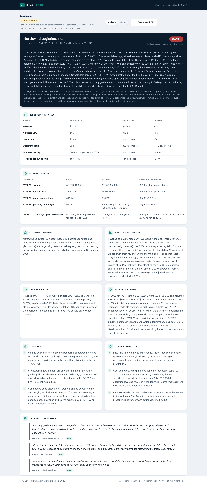
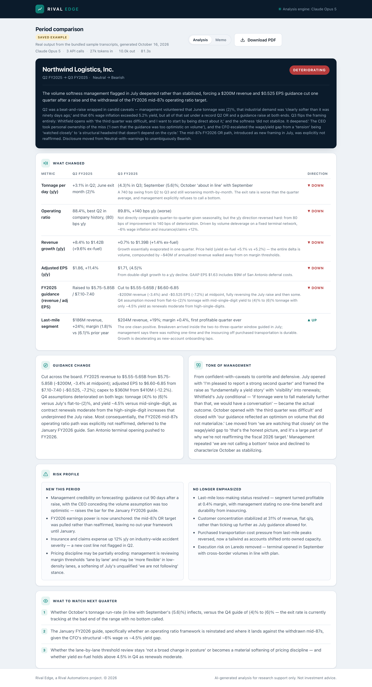
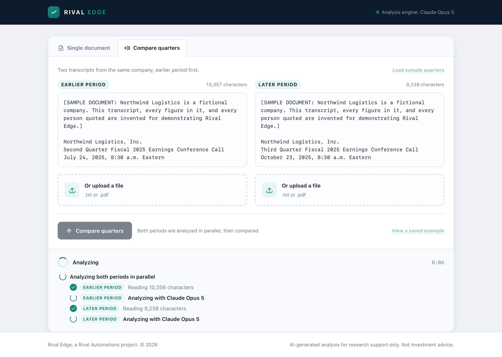
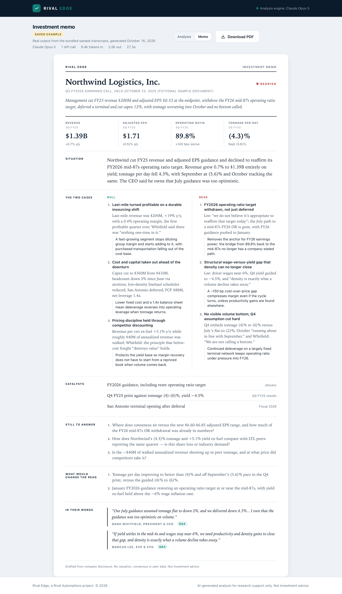
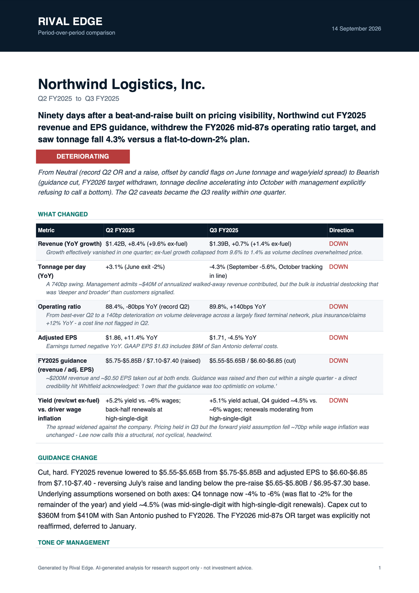
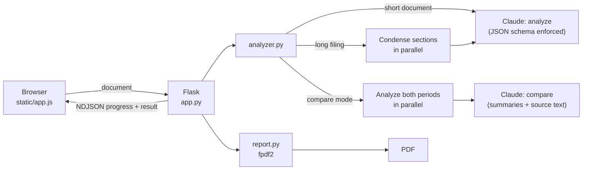

# Rival Edge

[](https://github.com/llmccormack/rival-edge/actions/workflows/ci.yml)


**An AI financial document analyzer that turns earnings call transcripts and 10-K filings into structured equity research notes.**

**[Try the live demo →](https://llmccormack.github.io/rival-edge/)** <sub>A static build showing saved output from real Claude runs, so no setup and no API key.</sub>

Paste a transcript, upload a filing, or pull one from EDGAR by ticker. Rival Edge returns the reported financials as a table, a guidance bridge showing what management changed and by how much at the midpoint, ranked risks and opportunities, verbatim quotes tagged by whether they came from prepared remarks or Q&A, and a read on the tone of the disclosure. It compares two quarters, drafts a one-page investment memo, and exports any view as a typeset PDF.



<sub>Real output from Claude Opus 5 on the bundled sample transcript. Northwind Logistics is a fictional company.</sub>

---

## Try it in a minute

```bash
git clone https://github.com/llmccormack/rival-edge.git
cd rival-edge
python3 -m venv .venv && source .venv/bin/activate
pip install -r requirements.txt
cp .env.example .env          # add your ANTHROPIC_API_KEY
python app.py
```

Open **http://127.0.0.1:5001**, click **Load sample transcript**, then **Analyze document**. To analyze a real company, type a ticker in the SEC EDGAR row (requires `SEC_USER_AGENT`, below).

No API key? The app still runs. It shows saved output from a real run, so you can explore every view and export a PDF without spending anything.

---

## What it does

### Structured analysis

Every run returns the same fields, in the order a reader actually scans them:

- **Reported financials**, as a table: metric, this period, prior year, change — not a paragraph of numbers.
- **A guidance bridge**: every forward number management raised, cut, reaffirmed or withdrew, with the move computed at the midpoint. On the sample quarter it returns "-$200M at midpoint, (3.4)%" rather than restating two ranges and leaving the arithmetic to you.
- **The period, unambiguously**: the fiscal label and the calendar months behind it, since fiscal years differ by company.
- **Three ranked risks and opportunities**, a company overview, and an analyst summary written as a note.
- **Three verbatim quotes, tagged by context.** An unscripted Q&A answer carries more weight than prepared remarks written by IR, so the model is told to prefer Q&A and to record where each quote was said.
- **A disclosure read** — Bullish, Neutral or Bearish — labelled in the interface as a read on the tone of the disclosure, not a view on the shares. The app has no price or valuation data and never implies one.

The model is told to use only figures that appear in the document and to write "Not disclosed" instead of guessing. On the sample transcripts, every quote in the saved output appears verbatim in the source.

### Filings straight from SEC EDGAR

Type a ticker, pick 10-K or 10-Q, and the app resolves the ticker to its SEC filer, finds the most recent filing of that type, and loads its text. Compare mode fetches the last two in one click. EDGAR serves filings as inline-XBRL HTML, so `documents.py` strips the machine-readable tagging, scripts, and layout markup while keeping table cells separated.

SEC requires every automated request to declare a contact address. Set `SEC_USER_AGENT` in `.env` before using this; without it the app says so instead of failing silently. SEC also blocks some networks outright, in which case download the filing from sec.gov and upload it — `.htm` is an accepted upload type.

### Quarter-over-quarter comparison

Give it two transcripts from the same company and it produces a delta table (metric, earlier, later, direction, commentary), the guidance change, how management's tone shifted, which risks are new and which faded, and what to watch next quarter.



### Live progress

Analysis takes from 20 seconds to a few minutes. The UI shows each stage as it actually starts on the server, not a timer cycling canned messages. In compare mode, you can watch both periods being analyzed at once.



### A one-page investment memo

From any result, *Draft memo* produces the disclosure-backed half of a pitch: the situation, four key figures, a bull and bear case with evidence for each claim, dated catalysts, two quotes worth saying out loud, and — the part that keeps it honest — the questions this document cannot answer, which need consensus, peer or valuation data.



It exports as a single page, set as a research note: a two-column grid with section labels in the gutter, serif body text, hairline rules, and colour reserved for one marker. The layout renders at progressively tighter settings until it fits one page, so a wordy quarter cannot spill onto a second. See [`docs/example-memo.pdf`](docs/example-memo.pdf).

### PDF export

Both views export as an A4 report with a delta table, directional colour coding, and page breaks that respect table rows. See [`docs/example-comparison.pdf`](docs/example-comparison.pdf).



---

## How it works



| Mode | Claude calls | Typical time | Tokens (in / out) | Approx. cost |
| --- | --- | --- | --- | --- |
| Single earnings call | 1 | ~43 s | 5.6k / 3.3k | $0.11 |
| Two-quarter comparison | 3 | ~81 s | 27k / 10k | $0.38 |
| Investment memo | 1 | ~28 s | 9.4k / 2.0k | $0.10 |

<sub>Measured on the sample transcripts. Cost at Claude Opus 5 list pricing ($5 / $25 per million tokens) when measured.</sub>

---

## Engineering decisions

These are the parts worth reading if you're reviewing the code.

**The output shape is enforced by the API, not parsed out of prose.** Both schemas are sent through `output_config.format`, so the response is always valid JSON with every field present. No stripping markdown fences, no defensive `.get()` on every key in the frontend.

That came with a constraint worth knowing about. Structured outputs reject `minItems`/`maxItems` values above 1, so "exactly three risks" can't live in the schema; the first version returned a 400 on every request. List lengths now live in the field descriptions, and `enforce_list_limits` trims the parsed result. That trim isn't theoretical: a live comparison once came back with seven deltas when the prompt asked for three to six. A test walks both schemas to keep unsupported constraints from coming back.

**The comparison reads the source documents, not just the two summaries.** The first version compared the two structured analyses only. In live testing, it reported that a Q3 customer-concentration figure was "not disclosed". It *was* disclosed, in the Q&A section, which the summary hadn't included. The comparison call now receives each period's analysis *and* its source text, with an instruction that a figure disclosed only in Q&A still counts. That added about 7k input tokens per comparison. A regression test covers it.

**Independent work runs concurrently.** In compare mode, the two period analyses have no dependency on each other, so they run on a thread pool: analyzing two quarters takes about as long as analyzing one. Long filings follow the same approach: sections are condensed in parallel, with results collected in document order. Token usage is aggregated across threads behind a lock.

**Long filings are condensed, never truncated.** Claude Opus 5's 1M-token context fits most filings in one pass. Past roughly 320k characters, the document is split on paragraph boundaries (with overlap) and each section is condensed into dense analyst notes that preserve figures and quotes. The analysis prompt then runs over those notes, and the UI discloses that it happened.

**Progress is streamed, and it's honest.** `/api/analyze` and `/api/compare` return newline-delimited JSON. The analyzer reports progress through a callback as each stage starts, and a worker thread feeds a queue that the Flask response generator drains. Errors arrive as events too; unexpected exceptions are logged server-side and never leaked to the client.

**Long runs can't hit a timeout or a length cap.** Every request streams, so multi-minute calls don't hit HTTP timeouts. Opus 5 thinks by default, and thinking counts toward `max_tokens`, so the ceiling is set high (64k) to leave room for reasoning. The call is still billed only for tokens actually used.

**The output is shaped like a note, not a summary.** The first version returned guidance as prose, which buried the most important item in any quarter inside a paragraph and left the reader doing arithmetic. Guidance is now a bridge with the midpoint move computed, reported financials are a table, and quotes record whether they came from the script or from Q&A. Tests assert that contract so the structure cannot quietly regress into prose.

**The memo refuses to fake a thesis.** It is told it does not know the share price and must not imply one, so there is no target, multiple, or buy/sell. What a pitch still needs — valuation, consensus, peer comparison — becomes the memo's "Still to answer" section instead of being invented. The PDF footer carries the same disclaimer.

**Print typography is treated as real typography.** The PDFs use Windows-1252 rather than fpdf2's Latin-1 default, so curly quotes, en and em dashes and ellipses survive from the filing instead of being flattened to typewriter marks, and a conservative pass upgrades straight quotes where it is unambiguous. The screen applies the same rules, so both read alike.

**Refusals degrade gracefully.** Requests opt into server-side refusal fallbacks, so if a safety classifier declines, the API re-runs the request on a fallback model within the same call. If the whole chain still refuses, the user gets a clear message instead of an empty card.

---

## Testing

```bash
pip install -r requirements-dev.txt
pytest          # 100 tests, ~8 seconds, no network
ruff check .
```

The suite never calls the real API. `conftest.py` clears the API key and points the SDK at a closed local port, so an accidental live call fails fast. The Claude integration is tested against a small local server that speaks the Messages streaming protocol, which lets the tests check what is actually sent over the wire. That covers model, streaming, schema, fallback headers, request concurrency, chunk ordering, and refusal, truncation, and auth failures. The EDGAR tests use JSON copied from live SEC responses, so the parsing is checked against what the API actually returns.

CI runs lint and tests on Python 3.10 through 3.13. A second workflow builds the static demo with `scripts/build_static_demo.py`, rendering the real template in demo mode, and deploys it to GitHub Pages on every push to `main`.

---

## Project structure

```
rival-edge/
├── app.py                     Flask routes and NDJSON progress streaming
├── analyzer.py                Claude integration: prompts, schemas, chunking, concurrency
├── documents.py               Ingestion: plain text, PDF, and EDGAR inline-XBRL HTML
├── edgar.py                   SEC EDGAR: ticker to CIK, recent filings, document download
├── report.py                  PDF report generation (fpdf2)
├── templates/index.html       Page markup
├── static/
│   ├── app.js                 Client: stream reader, rendering, export
│   └── style.css
├── samples/                   Fictional sample transcripts + saved real output
├── scripts/
│   ├── generate_examples.py   Regenerates samples/example-*.json from real runs
│   └── build_static_demo.py   Builds the GitHub Pages demo
├── tests/                     pytest suite with a local Messages API stub
└── docs/                      Screenshots and example PDFs
```

## Configuration

| Variable | Required | Purpose |
| --- | --- | --- |
| `ANTHROPIC_API_KEY` | For live analysis | Without it, the app serves saved examples only |
| `PORT` | No | Defaults to `5001`, since macOS reserves 5000 for AirPlay Receiver |
| `SEC_USER_AGENT` | For EDGAR | Contact address SEC requires on automated requests, e.g. `"Your Name you@example.com"` |
| `RIVAL_EDGE_FALLBACKS` | No | Set to `0` to disable server-side refusal fallbacks |
| `FLASK_DEBUG` | No | Set to `1` for auto-reload and interactive tracebacks during development |

## Tech

Python 3.10+ · Flask 3 · Anthropic Python SDK 1.x (Claude Opus 5) · pypdf · fpdf2 · vanilla JavaScript and CSS, with no build step and no database. EDGAR retrieval and HTML parsing use only the standard library. Documents are processed in memory and never written to disk.

## Limitations

- **A full 10-K costs more than a transcript.** A real annual report runs around 430,000 characters, which triggers the condensing path and costs roughly a dollar to analyze. Earnings calls are a few cents.
- **Scanned PDFs aren't supported.** Image-only PDFs have no text layer. The app detects this and asks for pasted text rather than analyzing an empty document.
- **Comparison assumes the same company.** Two different issuers produce a comparison, just not a meaningful one.
- **The memo is half a pitch.** It carries what the company disclosed. The thesis, the valuation and the variant view are yours.
- **Output is a research aid, not advice.** Verify figures against the source filing before relying on them.

## License

[MIT](LICENSE) © Luke McCormack · Built at [Rival Automations](https://rivalautomations.com)
